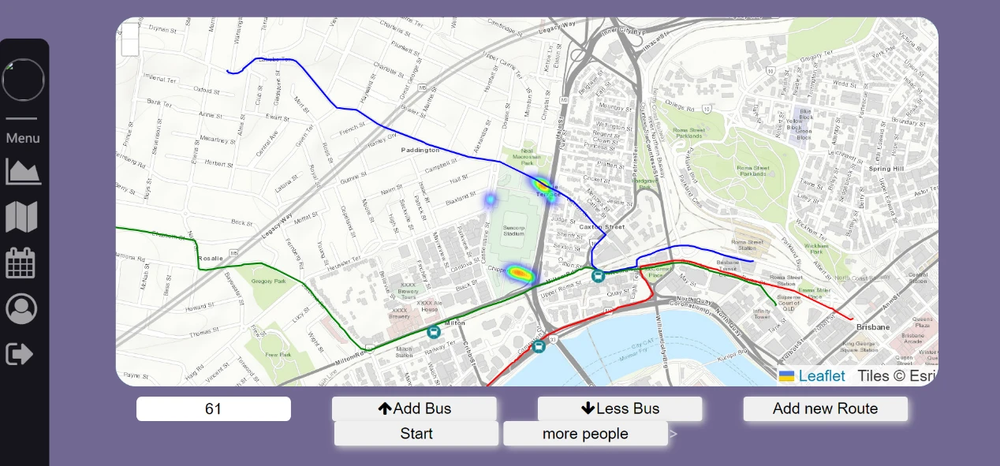

# EZ Bus — 交通仿真与调度可视化

**[打开在线交互演示](https://leoz-svg.github.io/ez-bus/) · [返回项目作品集](https://leoz-svg.github.io/ai-project-portfolio/)**

UQ **DECO3801 · Design Computing Studio 3 – Build** 团队项目（2023）。面向大型赛事散场场景，整合 Suncorp Stadium 周边的人流仿真、公交路线、数据图表与调度操作。

原作属于 **;p Winking Team**。Haoran Zheng 为团队成员；本仓库不将完整系统声明为个人独立作品。具体个人贡献应结合成员的真实分工说明。



## 直接体验

1. 打开在线演示，点击「开始仿真」。
2. 选择 61 / 412 / 475 号线路，增减公交，观察车辆与指标变化。
3. 增加一批 30 人，查看人流热区和各车站候车数。
4. 暂停、切换速度或重置；可以导出当前指标 CSV。

**部署范围：** GitHub Pages 仅托管静态文件。在线演示是本次发布时将原 Python 网格规则移植到 JavaScript 后制作的展示版，保留原项目 CSV 路网与线路数据，不依赖外部地图瓦片或服务器。它不是实时交通数据，也没有云端 Python 服务。原前后端代码位于 `source/`，并附带复现修复。

## 技术与方法

| 层次 | 原项目实现 | 关键工作 |
|---|---|---|
| 页面 | HTML、CSS、原生 JavaScript | Dashboard、调度按钮、司机表格、账号界面 |
| 地图 | Leaflet、Leaflet.heat | 底图、线路 polyline、公交 marker、人流热区 |
| 图表 | Chart.js | 人数、站点分布、线路公交数与车辆资源图表 |
| 数据 | CSV、Pandas / Python csv、PapaParse | 加载线路、人流与公交坐标；序列化给前端 |
| 服务 | Python、Flask、Flask-SocketIO | 事件推送和调度命令；后台仿真循环 |
| 模型 | 100 × 100 离散网格、实体状态更新 | 随机行人移动、道路限制、循环公交路径、到站上车 |
| 实验功能 | 拥堵阈值 + DFS 路径搜索 | 寻找经过拥堵点的候选路线；不保证最短或最优 |

原工程还包含 p5.js、ECharts 与 Font Awesome。当前原版主页面由 p5.js 的 `setup()` 初始化，主要图表使用 Chart.js；不能把目录中出现的所有库都当成核心功能。

### 核心数据流

```text
CSV 经纬度 → 100×100 网格 → Python 人流/公交状态
                                ↓ data_updated
                         Flask-SocketIO → 前端地图与图表
                                ↑ add_bus / drop_bus / raise_people
                             调度按钮
```

坐标转换：`x = int((latitude - MIN_LATITUDE) * 10000)`，`y = int((longitude - MIN_LONGITUDE) * 10000)`；前端绘图时将经度作为横轴、纬度作为纵轴。

### 这是 AI 项目吗？

**产品代码没有接入 LLM、Agent、MCP 或训练模型。** 这是规则仿真与 Web 可视化项目。原报告记录的生成式 AI 使用包括部分 CSS 调整、localStorage / 登录同步思路、Flask 环境配置辅助，属于 AI 辅助研发。

可以用它展示前后端集成、状态同步、空间数据处理与可操作工具界面的能力；不能声称实现了 AI 自动调度、机器学习人流预测或 MCP 工具。

## 本地运行完整前后端

建议使用 Python 3.12（本次验证版本），在独立虚拟环境中执行：

```powershell
git clone https://github.com/leoz-svg/ez-bus.git
cd ez-bus
python -m venv .venv
.venv\Scripts\python.exe -m pip install -r requirements.txt
.venv\Scripts\python.exe source/Backend/FLASK.py
```

macOS / Linux 对应使用 `.venv/bin/python`。

打开 **http://127.0.0.1:5000/**。教学账号为 `demo@example.com` / `demo-only`，也可使用页面上的跳过登录链接。

服务同时提供原前端和 Socket.IO，避免原安装流程里两个独立网页/后端端口带来的同源问题。本次已将 Leaflet、Socket.IO、Chart.js、PapaParse 与 Leaflet.heat 的固定版本及许可文件保存在 source/front end/vendor，避免 CDN 脚本加载失败。原前端仍需要联网加载 Esri 地图瓦片；GitHub Pages 展示版全部使用仓库内文件。

**账号说明：** 原登录与改密使用前端数组和 localStorage 明文数据，不是服务端认证，也没有实现报告所描述的加密保障。请勿输入真实密码。此次发布删除了原样例邮箱/电话，关闭 IP 查询，并保留明确标识的教学账号。原服务只监听本机地址，不应直接作为公网多用户服务使用。

### 仅运行在线展示版

```powershell
python -m http.server 8000 --directory docs
```

访问 http://127.0.0.1:8000/ 。请使用 HTTP 服务，不要直接双击 HTML 文件，以便浏览器加载模块与 JSON。

### 部署到 GitHub Pages

在仓库 Settings → Pages 选择 **Deploy from a branch → main → /docs**。该目录完全静态，不需要 Python、数据库、API 密钥或付费服务。

## 2026 年发布适配与修复

原始 ZIP 是 2023 年课程提交版本。下列工作为此次作品集整理新增，不能倒算为原课程成果：

- 新增浏览器规则移植、Canvas 路网、指标卡、车站人数、暂停/速度/固定种子重置、CSV 导出。
- 展示版使用实际生成/上车计数，满足 **已生成 = 地图内 + 已上车**；固定种子便于重置复现。Python 与 JavaScript 随机数序列不同，不保证逐帧轨迹一致。
- 统一本机前后端来源；连接时直接读取内存，避免 CSV 写入竞争以及初始对象/后续数组的格式差异。
- 后端状态修改增加锁与线路编号、数量限制；移除 debug reloader，避免重复启动仿真线程。
- 修复行人越界前访问数组、无限随机重试、空线路减车、未返回新路线数据等问题。
- DFS 改为显式栈以避免递归深度限制，并修正邻域循环；仍是候选路径启发式，不构成最优路线算法。
- 修复原前端空数组处理与不存在的初始化回调；显示部分后端错误和新路线结果。
- 移除虚拟环境、IDE 配置、缓存和样例联系方式。报告整本、成员学号和私人简历不公开上传；仅展示相关原型截图。

## 模型与原界面的已知限制

- 默认 `MAX_PEOPLE=2000`，但原循环 `i < 2000 / 30` 实际生成 **67 × 30 = 2,010 人**。展示版准确记录生成数量，而不将常量当成已离场人数基数。
- 行人随机向目标移动，没有完整寻路与校准，可能在局部道路被困；局部道路单元人数阈值为 80，但出生点不受该限制。
- 公交按离散点循环，线路末端直接回到起点。没有载客容量、信号灯、现实旅行时间、驾驶员排班约束。
- 行人在车站遇到公交即移出模型；“已上车”是模型中的移除计数，不代表真实送达目的地。
- 原前端的站点分布图含固定比例近似、预设 90 辆资源池；部分按钮先更新本地计数。没有实现多客户端权威状态协调，不应把原图表当成严格分析指标。
- 原版“暂停”仅暂停前端监听，后端继续运行；新的浏览器演示暂停的是本地引擎。
- 原版司机表使用样例记录；实验新线路功能没有移植到在线展示版。
- 没有接入 Translink 实时数据、数据库、生产账号系统或预测模型；不报告未经测量的调度效率提升。

## 验证

```powershell
node --test tests/engine.test.mjs
python -m unittest discover -s tests -p "test_*.py"
```

测试覆盖人数守恒、车辆数量一致、1,500 步交互仿真、重复重置、空/满/无效线路、人数上限、HTTP 页面与初始 Socket.IO 消息、后端命令及 500 步状态更新、候选路径合法性。网页另行验证桌面与窄屏显示、开始/暂停、增减车辆、追加人流、导出，以及控制台错误。

这些测试用于验证软件行为，**不构成交通模型有效性或现实运营准确率的评估**。

## 目录

```text
docs/                 在线交互展示（GitHub Pages）
  engine.mjs          原规则的 JavaScript 移植
  assets/network.json 从原 CSV 转换的网格数据
source/Backend/       Python / Flask-SocketIO 与仿真类
source/front end/     原前端（含复现修复）
tests/                模型与接口回归测试
requirements.txt      本机 Python 依赖
ATTRIBUTION.md        团队与第三方资源说明
```

## 项目来源

依据用户提供的 `EZ Bus(1).zip`、`EZ BUS.pdf`（项目报告）及 `instruction.pdf`（安装说明）整理。原说明采用 PyCharm 启动 Flask、IntelliJ 打开 HTML 的方式；本版给出独立于 IDE 的复现步骤。

本仓库用于学术作品展示。原团队代码与第三方依赖的权利仍属于各自作者；不擅自为整份团队作品添加统一开源许可证。见 [资源归属](ATTRIBUTION.md)。
